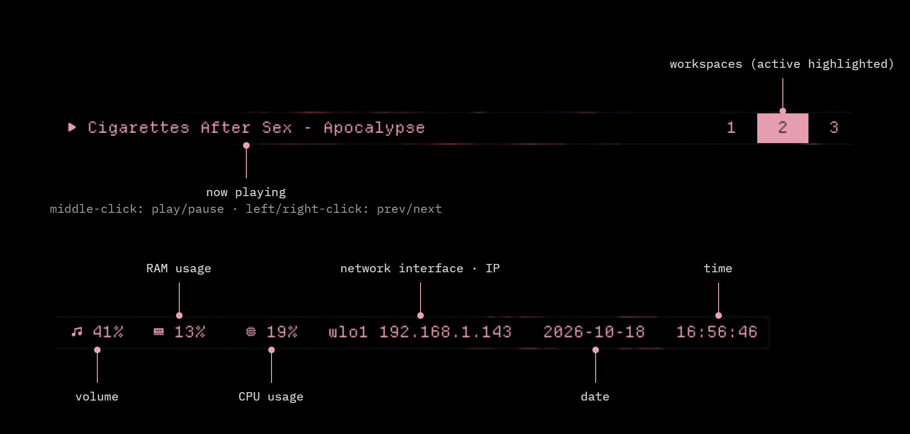

# debian-i3-dotfiles

My Debian 13 rice — i3wm, Polybar, Kitty, Picom & animated wallpapers.

## Preview


### Polybar



## Setup

- **OS:** Debian 13 / X11
- **WM:** i3 / gaps / pixel borders / Mod4
- **Bar:** Polybar / Cava / MPRIS / volume / system stats
- **Terminal:** Kitty / Ayaka / Zsh
- **Compositor:** Picom / blur / transparency / fading
- **Wallpaper:** xwinwrap + MPV / one video per active monitor
- **Font:** DepartureMono Nerd Font Mono
- **Included by default:** Fastfetch with bundled artwork
- **Optional:** GTK3 / Graphite-Dark / Qt5ct / Kitty cursor download

## Features

- Automatic monitor detection — no fixed outputs or resolutions.
- Bundled Lain video wallpaper, configured automatically; `--wallpaper` selects another local video.
- Launcher dry-runs and per-display singleton locks.
- Cleanup limited to each launcher's own children.

## Files

```text
config/     i3 / Polybar / Kitty / Picom / optional appearance
bin/        Wallpaper launchers + shared supervisor helper
packages/   Core and optional Debian package lists
assets/     Desktop preview + licensed DepartureMono fonts
docs/       Manual setup + portability notes
tests/      Repository, launcher and MPRIS checks
```

## Getting started

1. **Requirements:** existing Debian 13 i3/X11 session and an audio server.
2. **Packages:** [core](packages/debian.txt) / [optional](packages/optional-debian.txt).
3. **Fonts:** DepartureMono Regular/Mono are bundled and installed per-user if missing. **Animated wallpaper:** video bundled; missing xwinwrap is compiled per-user after package approval.
4. Preview with `./install.sh --dry-run`, then run `./install.sh` for the interactive installer.

The installer asks before copying files or installing packages, backs up originals and supports restore. See [setup & recovery](docs/setup.md) for component selection and options.

> The Kitty cursor can be downloaded with explicit approval and checksum verification. Other external theme assets and xwinwrap are not downloaded. Cloning this repository does not change your desktop.

## Checks

```sh
python3 -m unittest discover -s tests -v
```

- Automated tests use isolated external-program mocks.
- i3 / Polybar parser checks and real-monitor dry-runs completed.
- Fresh-install visual verification still pending.

[Manual setup & shortcuts](docs/setup.md) / [Portability & remaining work](docs/portability.md)
